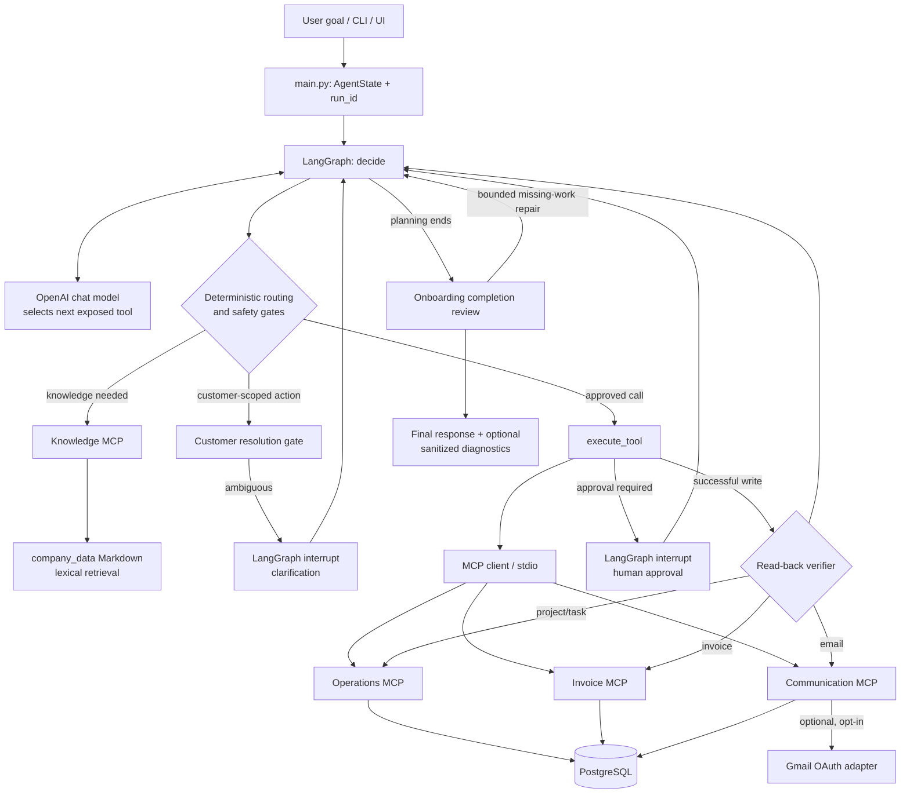

# Northstar Autonomy Engine

An autonomous business-task worker built for the **CentrAlign AI Engineering Intern** problem statement. You give it an outcome ("Onboard Acme Corp"); an LLM chooses tools, deterministic code decides what is allowed, and independent checks decide whether the work actually happened.

**Demo video:** [watch on Google Drive](https://drive.google.com/file/d/1DYABdb81gyfoJuLeNTGFjnv3MBB0hMKd/view?usp=sharing)

Scope is deliberately narrow: company documents, customer onboarding, invoices and controlled email, all against a simulated company (PostgreSQL plus local MCP tool servers). It is not a browser or desktop agent.

## The idea in one paragraph

An LLM that calls tools can look successful without being successful. So Northstar splits the work. **The model proposes** the next action. **The runtime enforces**: it resolves which customer is meant, requires the SOP and the governing contract before any onboarding write, applies email policy, pauses for human clarification or approval, bounds retries, and blocks repeated actions. **Verification is separate**: every write is read back from the system, and a second reviewer checks the persisted work against the contract and SOP.



## Try it

| Request | What it demonstrates |
| --- | --- |
| `Onboard Acme Corp` | "Acme Corp" resolves to the legal entity *Acme Corporation Inc.*; onboarding writes are blocked until the SOP and contract are retrieved; the project and tasks are read back; the completeness review derives the contract-driven work. In one development run it identified six requirements: security review, encryption and DPA verification, capacity review (1.2M transactions/month), technical architecture assessment (custom connector), timeline risk (go-live under 14 days) and SIEM log streaming. |
| `Onboard Acme` | Ambiguous short name: the run pauses with a clarification question instead of choosing an entity. |
| `Onboard Globex Corporation LLC` | The cleaner path through the same graph. |
| `Inspect the latest active invoice for Acme Corporation Inc.` | Picks the active revision (`INV-2026-1018-R1`) over the superseded original, then reconciles it with the invoice document: `VERIFIED`, `FAILED` or `INSUFFICIENT_EVIDENCE`. |
| `Send an onboarding update to Acme's verified technical contact.` | Email policy: a verified contact is allowed, an unverified recipient pauses for approval, credential-like content is denied. The result is read back from the outbox. |

## Quick start

You need Python 3.13, PostgreSQL, and an OpenAI API key.

```powershell
py -m venv .venv
.venv\Scripts\python.exe -m pip install -r requirements.txt
Copy-Item .env.example .env        # then set OPENAI_API_KEY and DATABASE_URL
```

Create the database once (any PostgreSQL client works), then initialize and seed it:

```powershell
psql -U postgres -c "CREATE DATABASE northstar;"
.venv\Scripts\python.exe -m app.database
```

Run from the command line (MCP servers start automatically):

```powershell
.venv\Scripts\python.exe -m app.main "Onboard Acme Corp"
```

Or run the browser demo, which shows each step, the verification evidence and the approval and clarification prompts:

```powershell
.venv\Scripts\python.exe -m uvicorn api.main:app --host 127.0.0.1 --port 8000
```

Then open <http://127.0.0.1:8000>. Run it as a single process without `--reload`, because runs are held in memory. Set `NORTHSTAR_DIAGNOSTICS=1` for a sanitized JSON trace of every action. Email defaults to a mock outbox; Gmail is opt-in.

## Why it is built this way

- **Model proposes, code enforces.** The model chooses tools freely; it cannot skip identity resolution, retrieval, policy or limits.
- **Evidence before action.** Onboarding writes need the SOP and a contract chunk naming the exact legal entity.
- **Verification is independent of the model.** Projects, tasks, invoices and emails are re-read from the system. A separate completeness review, which never sees the agent's reasoning, compares persisted tasks with the contract and SOP. A task only counts if it exists and its title names the requirement, so a generic "setup" task cannot satisfy six requirements.
- **Bounded recovery.** Only explicit transient failures retry (3 times). A run has a 20-tool-step budget. Completeness repair is limited to 2 rounds, then the run stops and reports the open work.
- **Human in the loop.** Ambiguity and risky actions pause the graph with LangGraph interrupts and resume on the same run.

Detail on each control, the verification matrix, the CentrAlign requirement mapping and the full architecture diagram are in [`docs/DESIGN.md`](docs/DESIGN.md).

**Generalization.** The same graph runs onboarding, invoice and email workflows. What changes between them is the tools, the documents and the verifier; the loop, gates, limits and human-in-the-loop handling are shared. Some gates are workflow-specific (onboarding evidence, invoice reconciliation), so this is generalization within a small domain, not a universal planner.

## Testing

```powershell
$env:COMMUNICATION_BACKEND = "mock"
.venv\Scripts\python.exe -m unittest discover -s tests -p "test*.py"
```

Last full run: **98 tests passed, 1 skipped** (the live Gmail test is opt-in). Tests added since were run individually. Several tests start real MCP subprocesses and use PostgreSQL, so a full run takes a few minutes. Most graph tests replace the model with scripted responses.

## Known limitations

- Retrieval is lexical Markdown matching, with no embeddings. The completeness review reads whole documents to compensate.
- The completeness review is an LLM judgment, guarded by deterministic checks; it can be `SKIPPED` and is not a guarantee of business completion. Write verification proves persisted fields, not that the real-world work was done.
- Real-model behavior has not been benchmarked over many repeated trials, and results vary by model. The default is `gpt-4o-mini` (override with `OPENAI_MODEL`).
- Checkpoints are in memory: pausing and resuming works only while the process stays alive.
- Narrow scope: no browser or GUI control, and the email policy is a small rule set, not authorization or DLP.
- Simulated company: seeded PostgreSQL data and Markdown documents, no migrations, no authentication on the demo UI.
- Each tool call starts a short-lived MCP subprocess, which is simple but slow.
- `graph.py` is large (about 2,800 lines). It holds the graph, nodes, guards and verifiers; splitting it is on the next-steps list.

## Assumptions

- The Markdown documents contain the current governing contract and the applicable procedures.
- Whoever resumes an interrupt is authorized to clarify or approve; roles are not modeled.
- Mock email is used for development and tests unless Gmail is deliberately configured.

## What I would build next

1. Durable checkpoints and authenticated approvers.
2. Stronger retrieval with document versioning, plus repeated-trial evaluation of real-model behavior.
3. Split `graph.py` into prompts, tools, guards, verification and completion modules (an audit and phased plan exist).
4. Role-, tenant- and data-classification-aware policy, with an auditable approval record.
5. Combine structured requirement extraction with human review for high-risk contractual interpretation.

## Stack and external services

| Component | Technology |
| --- | --- |
| Orchestration | LangGraph (state, conditional routing, interrupts, in-memory checkpoints) |
| Model | OpenAI `gpt-4o-mini` through LangChain / `langchain-openai` |
| Tools | FastMCP local stdio servers: knowledge, operations, invoices, communication |
| Data | PostgreSQL with SQLAlchemy async and asyncpg |
| Retrieval | Custom lexical scorer over Markdown in `company_data/` |
| Demo UI | FastAPI + Uvicorn, static HTML/CSS/JS with server-sent events |
| Optional | Gmail API with OAuth (off by default) |
| Tests | Python `unittest` |

## Repository layout

```text
app/agent/          graph, state, MCP client, diagnostics
app/database.py     schema, seed data, data access
app/retrieval/      lexical Markdown retrieval
app/policy/         email policy
mcp_servers/        local MCP servers
api/  ui/           demo adapter and frontend
company_data/       demo company, contract, policy and invoice documents
tests/              unit and async regression tests
docs/DESIGN.md      design notes and configuration reference
```

## Submission and continued development

The `main` branch contains the actual version submitted for evaluation. The
modularized agent implementation developed after submission is available on
the [`refactor/modularize-agent`](https://github.com/Sarada123-eng/NorthStar-Autonomous-Agent/tree/refactor/modularize-agent)
branch and is documented separately from the submission.
